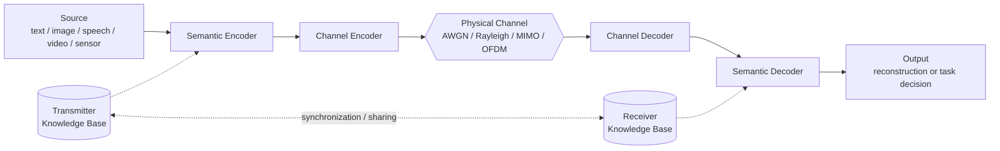

# Reference System Architecture

The diagram shows the reference SemCom pipeline. You can copy it into project docs. GitHub renders Mermaid blocks.

## Variants of this pipeline

| Variant | Description |
|---|---|
| **Separate semantic + channel coding** | The semantic encoder produces features. A conventional (possibly digital) channel code protects them. |
| **Joint semantic–channel coding** | One network contains both the semantic encoder and the channel encoder (DeepSC, DJSCC). |
| **Task-oriented (no reconstruction)** | The decoder outputs a decision directly (for example, a class label, bounding boxes or a control action). |
| **Generative** | The decoder is a generative model, conditioned on the received cues (prompt, latent, sketch, tokens). |
| **Split / edge inference** | The encoder is the head of a DNN on a device. The decoder is the tail on the edge server. The "semantic features" are intermediate activations. |
| **Token-based** | The encoder tokenizes the source with a foundation-model tokenizer. The system transmits the tokens with importance-aware protection. A large model recovers or completes them. |
