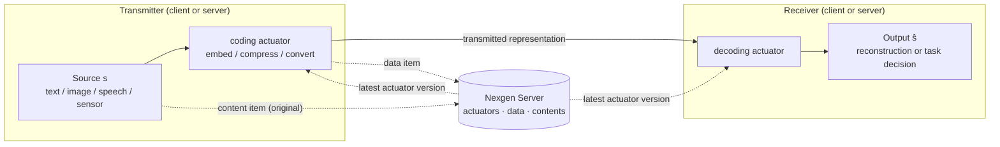

<div align="center">

# Nexgen Server

**A registry and data store for semantic communication applications.**

[](https://github.com/iamalreadynoob/nexgen-server/actions/workflows/ci.yml)
[](https://www.python.org/downloads/)
[](https://fastapi.tiangolo.com/)
[](https://www.mongodb.com/)
[](https://hub.docker.com/r/nexgensemantics/nexgen)
[](https://github.com/astral-sh/uv)

<p>
  <a href="#introduction">Introduction</a> •
  <a href="#setup">Setup</a> •
  <a href="#basic-concepts">Basic concepts</a> •
  <a href="#documentation">Documentation</a> •
  <a href="#contact">Contact</a>
</p>

</div>

---

## Introduction

Nexgen Server is a FastAPI and MongoDB service for semantic communication (SemCom) applications. It stores the methods that process data on each side of a link, the data that the link carries, and the original content.

SemCom is a communication paradigm. Its design objective is the correct delivery of the *meaning*, or of the *task-relevant content*, of a message. Its objective is not the bit-exact copy of the transmitted symbols. Thus the methods at each end of the link are as important as the link itself.

Nexgen Server keeps these methods, called **actuators**, in one place. Each actuator has a name and a version. Transmitters and receivers get the latest version of an actuator from the server. They run it, and they can store the result as a **data** item. A **content** item keeps the original input for later use.



Nexgen Server supports two objectives:

- **Semantic-level communication.** The decoding actuator recreates the source, or its meaning, from the received representation.
- **Goal-oriented (task-oriented) communication.** The decoding actuator identifies the input or does a task with it, for example classification. It does not recreate the source.

The server stores actuators and records. It does not run actuator code. The applications that call the API run the actuators.

To connect a Python application to the API, use the [**nexgenpy**](https://github.com/iamalreadynoob/nexgen) module. It is designed for the Nexgen Server REST API.

> [!TIP]
> Do you use [Claude Code](https://claude.com/claude-code)? The [nexgen api skill](https://github.com/iamalreadynoob/nexgen-server-skill) gives Claude Code the knowledge to use `nexgenpy` in your projects. Install it to get help when you register, load and use actuators.

## Setup

### Requirements

- Docker and Docker Compose, **or** Python 3.12 with [uv](https://github.com/astral-sh/uv) and a MongoDB server
- Git (only to build from source or to run locally)

There are two ways to run Nexgen Server with Docker Compose:

| Option | Compose file | Use it when |
|---|---|---|
| [Use the Docker Hub image](#option-1-use-the-docker-hub-image) | `docker-compose.yaml` | You want to run the server. You do not need the source code. |
| [Build from source](#option-2-build-from-source) | `docker-compose-dev.yaml` | You want to change the code, or run an unreleased version. |

The two options start the same services: the API and MongoDB 7. Both read the same `.env` file.

### Option 1: Use the Docker Hub image

The image is [`nexgensemantics/nexgen`](https://hub.docker.com/r/nexgensemantics/nexgen) on Docker Hub.

1. Make a directory and download the Compose file and the environment template:

   ```bash
   mkdir nexgen-server && cd nexgen-server
   curl -O https://raw.githubusercontent.com/iamalreadynoob/nexgen-server/main/docker-compose.yaml
   curl -o .env https://raw.githubusercontent.com/iamalreadynoob/nexgen-server/main/.env.example
   ```

2. Set `MONGO_ROOT_USERNAME` and `MONGO_ROOT_PASSWORD` in `.env`.
3. Set `API_KEY` in `.env`. If you do not set a key, the API is open to all callers.
4. Pull the image and start the API and MongoDB:

   ```bash
   docker compose pull
   docker compose up -d
   ```

5. Check the service:

   ```bash
   curl http://localhost:8000/api/v1/health
   # {"status":"ok"}
   ```

To update to the latest image, run `docker compose pull` and `docker compose up -d` again. The MongoDB data stays in the `nexgen_mongo_data` volume.

### Option 2: Build from source

1. Clone the repository:

   ```bash
   git clone https://github.com/iamalreadynoob/nexgen-server.git
   cd nexgen-server
   ```

2. Copy the environment template:

   ```bash
   cp .env.example .env
   ```

3. Set `MONGO_ROOT_USERNAME`, `MONGO_ROOT_PASSWORD` and `API_KEY` in `.env`, as in Option 1.
4. Build the image and start the API and MongoDB:

   ```bash
   docker compose -f docker-compose-dev.yaml up --build
   ```

5. Check the service with the same `curl` command as in Option 1.

### Notes for both options

- Docker Compose makes `MONGODB_URI` from the MongoDB user name and password. You do not set it in `.env`.
- The API listens on port 8000. To use a different port, set `API_PORT` in `.env`.
- To stop the services, run `docker compose down` (add `-f docker-compose-dev.yaml` for Option 2). To also delete the MongoDB data, add `-v`.

### Run locally with uv

1. Clone the repository, then install the dependencies:

   ```bash
   uv sync
   ```

2. Copy `.env.example` to `.env`.
3. Add `MONGODB_URI` to `.env` if MongoDB is not at `mongodb://localhost:27017`.
4. Start the development server:

   ```bash
   uv run uvicorn app.main:app --reload
   ```

5. Open the interactive API documentation at <http://localhost:8000/docs>.

The `/docs` page is not available when `ENVIRONMENT=production`.

### Send a first request

Register a coding actuator:

```bash
curl -X POST http://localhost:8000/api/v1/actuators \
  -H "X-API-Key: <your-key>" \
  -H "Content-Type: application/json" \
  -d '{
        "name": "text-embedder",
        "version": "1.0.0",
        "actuator_type": "coding",
        "requirements": ["numpy"],
        "method": "def encode(text: str) -> list[float]:\n    ...",
        "set_latest": true
      }'
```

Get the latest version of that actuator:

```bash
curl -H "X-API-Key: <your-key>" \
  http://localhost:8000/api/v1/actuators/text-embedder/latest
```

See [Configuration](docs/configuration.md) for all settings, and the [API reference](docs/api/overview.md) for all endpoints.

## Basic concepts

| Concept | What it is | Collection |
|---|---|---|
| **Actuator** | A versioned, named Python method that processes data. Its type is `coding` or `decoding`. | `actuators` |
| **Data** | The output of an actuator, as the link carries or uses it. Each data item refers to the actuator that made it. | `data` |
| **Content** | The original version of the data. Applications can load it again, for example to compare it with a reconstruction. | `contents` |

### Actuators

An actuator does one processing step in a SemCom pipeline. Examples are data embedding, compression and format conversion.

- A **`coding`** actuator changes a source into a representation for transmission. It can be a semantic encoder, a channel encoder or a joint source–channel coding (JSCC) encoder.
- A **`decoding`** actuator changes a received representation into an output. The output is a reconstruction of the source or a task decision.

Each actuator has a `name` and a `version`. The pair is unique among active actuators. For each name, exactly one active version has `latest: true`. Clients get the latest version through `GET /actuators/{name}/latest`. Thus the transmitter and the receiver can use the same version.

### Data

A data item stores the `metadata` that an actuator made, for example an embedding vector. It also stores the `actuator_id` of that actuator, an optional `linked_resource` that refers to the original input, and free-form `specs`. The server accepts a new data item only from the **latest** version of an actuator.

### Content

A content item stores an `identifier` for an original input and free-form `specs` that describe it. Data items can refer to a content item through `linked_resource`. Some applications load the original content to evaluate a reconstruction or to train a model again.

### Shared rules

- All endpoints are under `/api/v1`.
- All endpoints except health need the `X-API-Key` header when `API_KEY` is set.
- A delete operation is a soft delete. It sets `active: false`, and the item no longer appears in the results.

[Concepts](docs/concepts.md) gives more detail about SemCom and about how Nexgen Server fits a SemCom pipeline.

## Documentation

| Document | Contents |
|---|---|
| [Concepts](docs/concepts.md) | SemCom background, the two objectives, and how actuators, data and contents fit a SemCom pipeline |
| [Architecture](docs/architecture.md) | Code layers, request flow, storage model and the actuator version rules |
| [Configuration](docs/configuration.md) | Environment variables, API key authentication, Docker and logging |
| [API overview](docs/api/overview.md) | Base URL, authentication, pagination, IDs and error responses |
| [Actuators API](docs/api/actuators.md) | Endpoints to create, list, get, promote and delete actuators |
| [Data API](docs/api/data.md) | Endpoints to create, list, get, update and delete data items |
| [Contents API](docs/api/contents.md) | Endpoints to create, filter, get, update and delete content items |
| [Health API](docs/api/health.md) | Liveness and readiness probes |
| [Development](docs/development.md) | Tests, lint, CI and code conventions |
| [Security](docs/security.md) | API security, risks of stored actuator code, and SemCom threats |
| [Glossary](docs/glossary.md) | SemCom and project terms |
| [References](docs/references.md) | Surveys and papers about SemCom |

## Contact

Do you have a question, an idea or a problem? Send an email to [dev.nexgen.semantics@gmail.com](mailto:dev.nexgen.semantics@gmail.com).

To report a bug or to request a feature, you can also [open an issue](https://github.com/iamalreadynoob/nexgen-server/issues).
