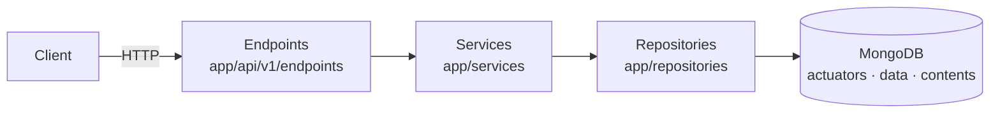

# Architecture

This document describes the code structure of Nexgen Server, the request flow and the storage model. For the SemCom background, see [Concepts](concepts.md).

## Technology

| Part | Technology |
|---|---|
| Web framework | FastAPI |
| Database | MongoDB 7, through the async PyMongo client (`AsyncMongoClient`) |
| Settings | pydantic-settings |
| Production server | Gunicorn with Uvicorn workers (4 workers, port 8000) |
| Python | 3.12 |

## Layers

The code has four layers. FastAPI `Depends` connects them in [`app/api/deps.py`](../app/api/deps.py).



| Layer | Folder | Function |
|---|---|---|
| **Endpoints** | `app/api/v1/endpoints` | Receive the HTTP request. Pass the query and path parameters to the service. They contain no business rules. |
| **Services** | `app/services` | Apply the business rules, for example name and version uniqueness and the latest flag. Raise the errors in `app/core/exceptions.py`. Return Pydantic models. |
| **Repositories** | `app/repositories` | Own all MongoDB queries. Return raw dicts. |
| **Schemas** | `app/schemas` | Define the request and response models. |

### Folder layout

```text
app/
├── main.py                 # create_app(), lifespan, request-ID middleware
├── api/
│   ├── deps.py             # DB -> repository -> service wiring
│   └── v1/
│       ├── router.py       # public and protected routers
│       └── endpoints/      # actuators, data, contents, health
├── core/
│   ├── config.py           # Settings (environment variables / .env)
│   ├── exceptions.py       # custom errors and their HTTP handlers
│   ├── logging.py          # stdout and rotating file logs
│   └── security.py         # X-API-Key check
├── db/mongo.py             # Mongo client and get_database
├── repositories/           # Mongo queries
├── schemas/                # Pydantic models
└── services/               # business rules
tests/
└── unit/api/v1/            # endpoint tests
```

## Request flow

1. The middleware in `app/main.py` reads the `X-Request-ID` header. If the header is not there, the middleware makes a new UUID.
2. For a protected route, `verify_api_key` compares the `X-API-Key` header with each configured key in constant time.
3. The endpoint calls the service.
4. The service calls one or more repository methods and applies the business rules.
5. If a rule fails, the service raises an error. A global handler changes the error into an HTTP response. See [error responses](api/overview.md#error-responses).
6. The middleware adds `X-Request-ID` to the response and logs the method, path, status code and duration.

### Routers

`app/api/v1/router.py` has two routers:

- `api_router` holds the public routes. At this time, only the health routes are public.
- `protected` holds the routes that need an API key. The actuators, data and contents routers are in `protected`.

The app mounts all routes under `/api/v1`.

### MongoDB client

The `lifespan` function in `app/main.py` makes one `AsyncMongoClient` for each process. It stores the database on `app.state.db`. `get_database` reads the database from the request. The lifespan closes the client when the process stops.

## Storage model

Each resource has one MongoDB collection.

| Collection | Schema module | Main fields |
|---|---|---|
| `actuators` | `app/schemas/actuator.py` | `name`, `version`, `actuator_type`, `requirements`, `method`, `method_args`, `latest` |
| `data` | `app/schemas/data.py` | `actuator_id`, `metadata`, `linked_resource`, `specs` |
| `contents` | `app/schemas/contents.py` | `identifier`, `specs` |

All documents also have these fields:

| Field | Meaning |
|---|---|
| `_id` | The MongoDB ObjectId. The API returns it as a string. |
| `created_at` | The UTC time of creation |
| `updated_at` | The UTC time of the last update |
| `active` | `false` after a delete. The API does not return it. |

### Soft delete

A delete operation keeps the document in the collection. It sets `active: false`. All repository queries filter on `active: true`, so a deleted item no longer appears in the results.

### IDs

Repositories change string IDs into ObjectIds with `_oid()`. If a string is not a valid ObjectId, `_oid()` returns `None`, and the service returns 404 Not Found.

## Actuator version rules

The `ActuatorService` applies these rules:

| Operation | Rule |
|---|---|
| Create | The `name` and `version` pair must not exist among active actuators. Else the server returns 400. |
| Create | If no active actuator has the name, the new actuator becomes the latest, even with `set_latest: false`. |
| Create | If `set_latest` is `true`, the previous latest version loses its latest flag. |
| Set latest | The actuator must exist. It must not be the latest already, else the server returns 400. The previous latest version loses its latest flag. |
| Delete | The latest version cannot be deleted. The server returns 409. Mark a different version as latest first. |

The `DataService` accepts a new data item only if its `actuator_id` is the latest active version of an actuator. Else it returns 404.

## Logging

Logs go to stdout and to a rotating `app.log` file in the working directory. The `LOG_LEVEL` setting controls the level. Each request log line contains the request ID.
