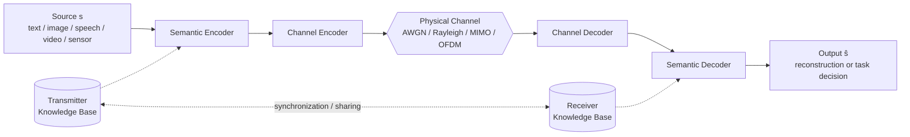
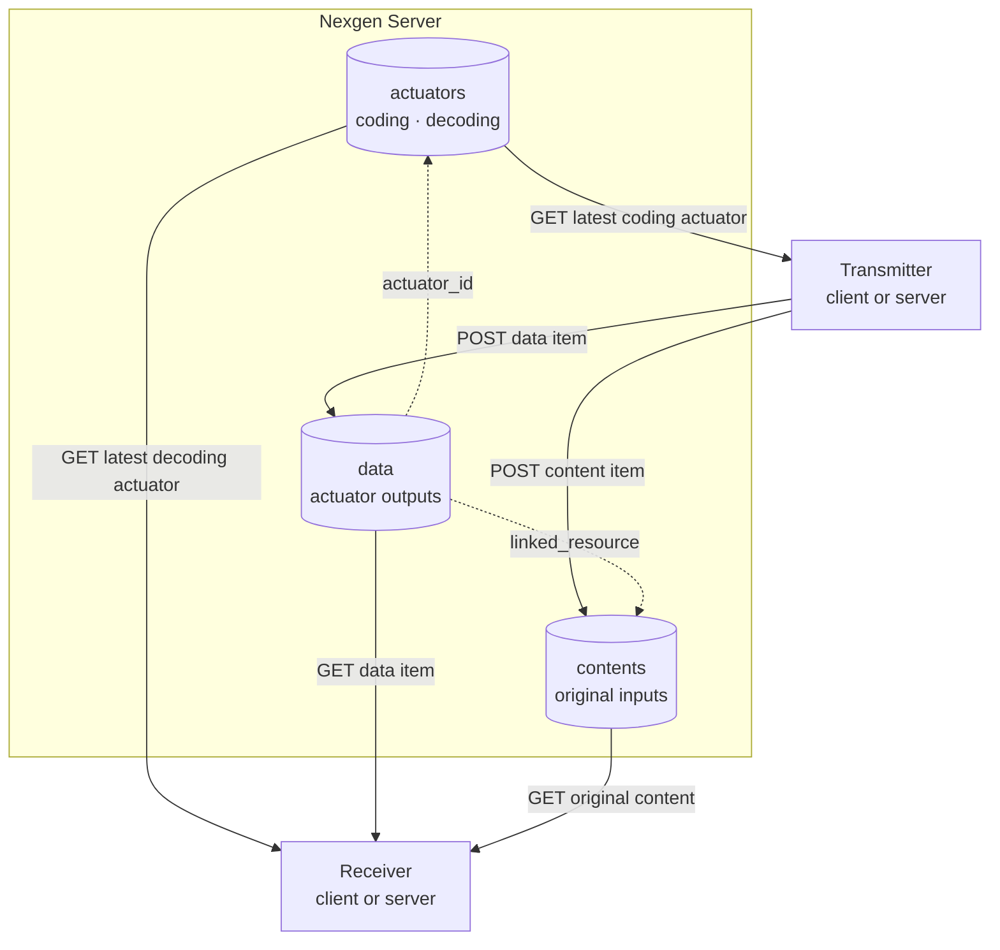

# Concepts

This document explains semantic communication (SemCom) and how Nexgen Server fits a SemCom pipeline. For the API details, see the [API overview](api/overview.md).

## What is semantic communication?

SemCom is a communication paradigm. Its design objective is the correct delivery of the *meaning*, or of the *task-relevant content*, of a message. Its objective is not the bit-exact copy of the transmitted symbols.

Classical (Shannon) systems treat the link as a pipe that ignores content. They measure success with the bit error rate (BER) or the block error rate (BLER). SemCom changes the objective from **symbol fidelity** to **semantic fidelity**. In its goal-oriented form, the objective is **task success**.

The literature usually frames the field with Warren Weaver's three levels of communication (1949):

| Level | Problem | Question | Typical metric |
|---|---|---|---|
| **A — Technical** | Syntactic | How accurately can the symbols be transmitted? | BER, BLER, PSNR |
| **B — Semantic** | Meaning | How precisely do the symbols convey the intended meaning? | Sentence similarity, LPIPS, semantic distortion |
| **C — Effectiveness** | Goal | How effectively does the received meaning achieve the goal? | Task accuracy, control cost, AoI/VoI |

Level B is SemCom in the narrow sense. Level C is goal-oriented (task-oriented) communication. Most current literature puts both levels under the SemCom name.

The field has no agreed definition or unit of semantic information yet.

### Why SemCom matters

- A system that sends only the semantically relevant information needs less bandwidth and power, and has lower latency.
- Learned joint source–channel coding (JSCC) schemes lose quality gradually at a low signal-to-noise ratio (SNR). They do not fail abruptly.
- 6G networks are expected to carry machine-to-machine and agent-to-agent traffic. In that traffic, the receiver is often a model that does a task, not a human who views raw data.

## The two objectives

Nexgen Server supports both objectives. Each application must say which objective it uses.

| Objective | What the receiver does | Decoding actuator output |
|---|---|---|
| **Semantic-level** | It recovers the meaning of the source. | A reconstruction `ŝ` of the source, for example a sentence or an image |
| **Goal-oriented** | It does a task with the received representation. | A task decision, for example a class label or a control action |

## The reference pipeline

The diagram shows the reference SemCom pipeline from the literature.

| Block | Function |
|---|---|
| **Semantic encoder** | Extracts a compact representation `z` of the meaning, or of the task-relevant features, of the source `s`. |
| **Channel encoder** | Protects the features against channel impairments. It makes the channel input `x`. |
| **Physical channel** | Changes `x` into `y = h·x + n`, where `h` is the channel coefficient and `n` is noise. |
| **Channel decoder** | Recovers the features from `y`. |
| **Semantic decoder** | Interprets the received representation. It recovers the meaning, reconstructs the source, or outputs a task decision. |
| **Knowledge base (KB)** | Shared background knowledge, such as datasets, trained model weights or codebooks. The transmitter KB is `K_T` and the receiver KB is `K_R`. |

In learned systems, one network often contains both the semantic encoder and the channel encoder. This design is called JSCC. Deep JSCC (DJSCC) uses neural networks for the encoder and the decoder, trained end-to-end through a channel model.

## How Nexgen Server fits the pipeline

Nexgen Server is not a link and not a channel model. It is the registry and the data store that the transmitter and the receiver share.

### Actuators

An actuator is a versioned, named Python method. Its `actuator_type` gives the direction of the step:

- A **`coding`** actuator changes a source into a representation for transmission. Examples are data embedding, compression and format conversion. It can implement a semantic encoder, a channel encoder or a joint (JSCC) encoder.
- A **`decoding`** actuator changes a received representation into an output. On the receiver side, it recreates the input (semantic-level) or identifies it (goal-oriented).

The actuator type does not name a single pipeline block. The application decides which block each actuator implements.

Actuators can run on the client side or on the server side. Nexgen Server stores the source code in `method` and the Python packages in `requirements`. It does not run the code.

### Versions and the latest flag

The transmitter and the receiver must use compatible actuators. A mismatch between them is similar to a background knowledge mismatch: it can cause misinterpretation even when the link has no errors.

Nexgen Server reduces this risk with versions:

1. Each actuator has a `name` and a `version`. The pair is unique among active actuators.
2. For each name, exactly one active version has `latest: true`.
3. Clients get `GET /actuators/{name}/latest` to find the version to use.
4. The server accepts a new data item only from the latest version of an actuator.

A model's weights or codebook are part of the KB. If an actuator loads them, give each change of the weights a new actuator version.

### Data

A data item is the output of an actuator, as the link carries or uses it. Examples are an embedding vector, a quantized index sequence or a compressed payload.

| Field | Meaning |
|---|---|
| `actuator_id` | The ID of the actuator that made the output |
| `metadata` | The output itself, as any JSON value |
| `linked_resource` | A reference to the original input, for example a content `identifier`. The server does not check this value. |
| `specs` | Free-form information, for example the channel model, the SNR or the channel bandwidth ratio (CBR) |

### Contents

A content item stores the original version of the data. It has an `identifier` and free-form `specs`, for example the modality, the format or a storage location.

Applications can load the original content for different purposes:

- To compare a reconstruction `ŝ` with the source `s`
- To train or fine-tune an actuator model again
- To audit what a data item came from

## Evaluating actuators

If an application reports the performance of an actuator, state these six items for each result:

1. Source modality
2. Channel model
3. SNR range for training and for test
4. CBR
5. Metric
6. Baseline

Show performance as a function of SNR and as a function of CBR. Say if the training SNR and the test SNR are different. Compare with a strong separate source–channel coding (SSCC) baseline, for example BPG/VVC + LDPC/Polar with adaptive MCS.

Typical metrics for each modality:

| Modality | Metrics |
|---|---|
| Text | BLEU, sentence similarity (BERT / SBERT cosine), BERTScore |
| Image / video | PSNR, SSIM, MS-SSIM, LPIPS, FID, CLIP score |
| Speech | PESQ, STOI, SDR |
| Task-oriented | Classification accuracy, detection mAP, retrieval recall |
| Goal / timing | AoI, VoI, AoII, control cost, task completion latency |

You can store these values in the `specs` of a data item.

### Generative decoding actuators

A decoding actuator can be a generative model, such as a diffusion model or a large language model (LLM). It regenerates content from compact cues. Such content can look correct but be wrong (hallucination). Check generative outputs with a semantic consistency metric, for example CLIP score or sentence similarity, and not only with a perceptual metric.

## Further reading

- [Glossary](glossary.md) defines the terms in this document.
- [References](references.md) lists surveys and core papers.
